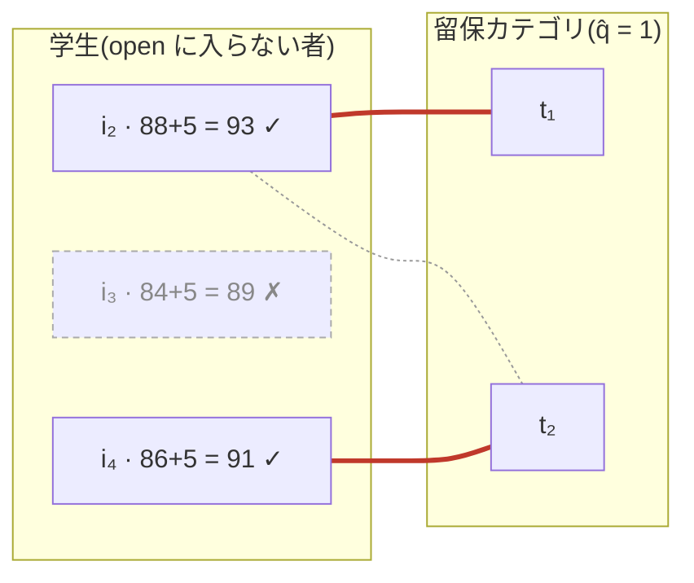
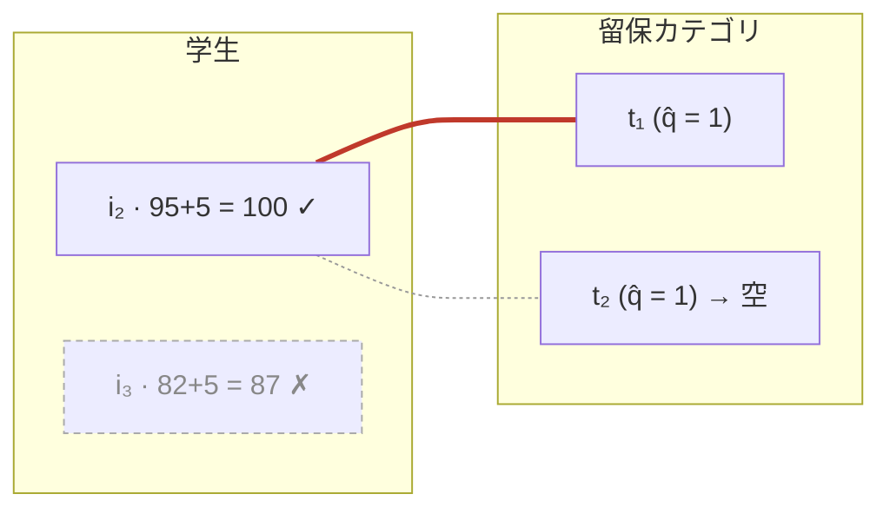
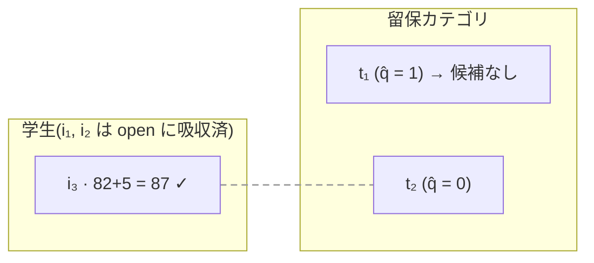
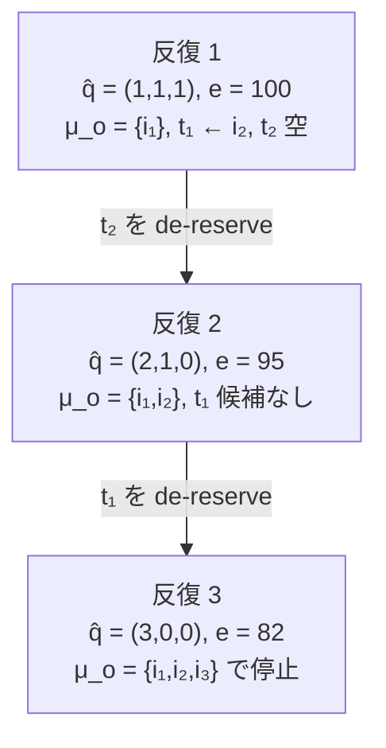
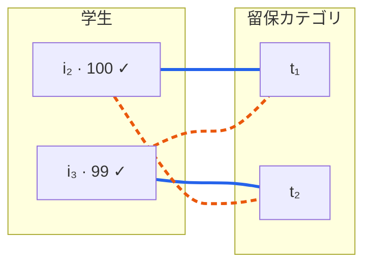

# PA-ODR: 重複適合の動作例(feasibility graph $G(e)$)

`tex/slides.tex` の PA-ODR 4〜6 に入れた TikZ 図の Mermaid 版。
凡例は全図共通で、**太い赤線 = 採用された辺**、細い灰線 = $G(e)$ にあるが不採用、
灰の破線 = 辺はあるが容量 0、点線枠 = $\sigma(i)+k < e-\delta$ で不適格。

---

## 例 A: 基準 1 が選好を上書きし、de-reserve は起きない

$q^o=q^{t_1}=q^{t_2}=1$, $k=5$, $\delta=10$;
$i_1(100,\emptyset)$, $i_2(88,\{t_1,t_2\})$ [$t_2 \succ t_1 \succ o$], $i_3(84,\{t_1\})$, $i_4(86,\{t_2\})$

$\mu_o=\{i_1\}$, $e=100$ なので admissible の条件は $\sigma(i)+5 \ge 90$。

最大カーディナリティ 2 を達成する割当は $i_2 \mapsto t_1$, $i_4 \mapsto t_2$ の**一意**。
$i_2$ は $t_2$ を好むのに $t_1$ へ回される — 重複適合者の行き先は**まず基準 1 が決める**。
全席が埋まるので即停止($\hat q$ 不変)、gap は $7, 9 \le \delta$。

---

## 例 B: 振り分けが de-reservation を連鎖させる

$i_1(100,\emptyset)$, $i_2(95,\{t_1,t_2\})$ [$t_1 \succ t_2 \succ o$], $i_3(82,\{t_2\})$,
$q=(1,1,1)$, $k=5$, $\delta=10$

### 反復 1: $G(100)$、条件 $\sigma(i)+5 \ge 90$

$i_2$ はどちらのカテゴリでも加点後 100 で「弱すぎる候補」ではない。
基準 3 が第一志望 $t_1$ へ流したこと自体が $t_2$ を空にする → $t_2$ を de-reserve。

### 反復 2: $G(95)$、条件 $\sigma(i)+5 \ge 85$

$i_3$ は今回 admissible になるが、唯一の適合先 $t_2$ の容量は既に 0。
$t_1$ には辺が無い($i_2$ が open に吸収された)ので、再び de-reserve。

### 反復の連鎖

3 人全員がマッチするが**両方の留保枠が消滅**する。
同じ事例で TA-DA は $\mu_o=\{i_1\}$, $\mu_{t_1}=\{i_2\}$ と枠を保ったまま 2 人を取る。

---

## 例 C: 重複適合者は虚偽申告で得をしうる

$i_1(100,\emptyset)$, $i_2(95,\{t_1,t_2\})$, $i_3(94,\{t_1,t_2\})$, $q=(1,1,1)$, $k=5$, $\delta=10$。
真の選好は $t_1 \succ_{i_2} t_2 \succ_{i_2} o$、$o \succ_{i_3} t_1 \succ_{i_3} t_2$。
$\mu_o=\{i_1\}$, $e=100$ で 4 辺すべてが現れ、基準 1–2 は両者のマッチを確定させる。

青実線 = 割当 $\alpha$($i_2 \mapsto t_1$, $i_3 \mapsto t_2$)、
橙破線 = 割当 $\beta$($i_2 \mapsto t_2$, $i_3 \mapsto t_1$)。決めるのは基準 3 だけ。

| $i_2$ の申告 | $\alpha$ | $\beta$ | 選択 |
|---|---|---|---|
| 真 $t_1 \succ t_2 \succ o$ | $(3,1)$ | $(2,2)$ | $\beta$: 第二志望 $t_2$ |
| 偽 $t_1 \succ o \succ t_2$ | $(3,1)$ | $(3,2)$ | $\alpha$: 第一志望 $t_1$ |

値は順位ベクトルの降順ソート、辞書式に小さい方が選ばれる。
$t_2$ を $o$ の下に落とすと $r_{i_2}(t_2)$ が $2 \to 3$ となり、$\beta$ の評価**だけ**が悪化する。
単一適合では起こりえない(振り分けの余地がないため)。

---

数値・反復トレースは `algorithms/admissions.py` の `pa_odr` で実行して再現を確認済み。
本文での対応箇所は `icaart_26___score/main.tex` の Remark `sec:trigger`(例 B)、
Prop. `paodr-notsp`(例 C)、および 527 行以降のコメントアウト部分(例 A)。
